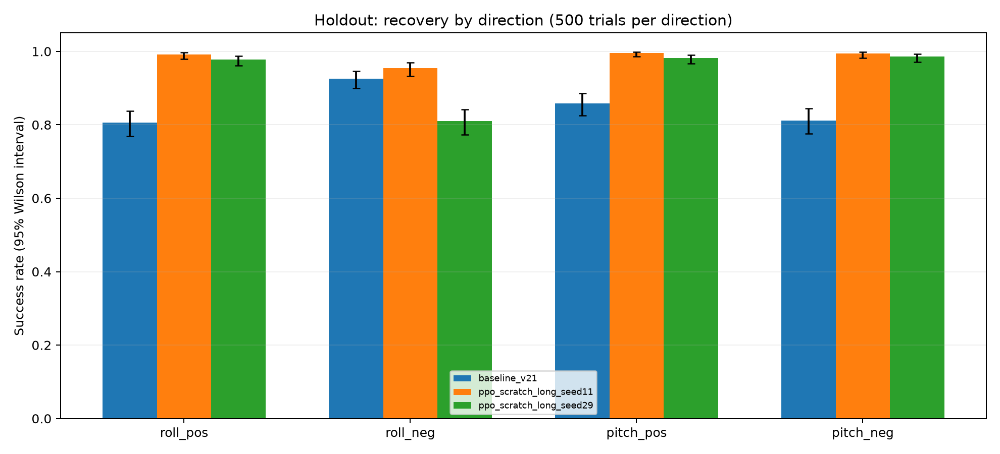

# Zihao's ATOM S3R self-rising robot — V3.1

A self-contained ATOM S3R variant of this project, using the original two-servo robot design. It includes a battery-aware MuJoCo model, a PPO actor learned from scratch, and the V3.1 continuous-control firmware. Existing project files are unchanged.

[中文说明](README.zh-CN.md) · [Training and evaluation](docs/TRAINING.md) · [Instructions for AI contributors](AGENTS.md)

## Release contents

| Path | Contents |
|---|---|
| `simulation/robo_s3r.xml`, `simulation/assets/` | MuJoCo MJCF and all referenced meshes |
| `models/robo_s3r_v3.zip` | Selected Stable-Baselines3 PPO checkpoint |
| `firmware/robo03_atom_s3r_zihao_v3/` | Complete Arduino sketch and exported actor header |
| `manifest.json` | Version, hashes, interface and validation provenance |
| `evaluation/` | Raw held-out episodes, training logs, comparison results and PNG plots |
| `simulation/play_policy.py` | Interactive playback or headless continuous-control check |
| `simulation/train_scratch.py` | Train a new scratch PPO policy without modifying release weights |
| `simulation/evaluate_policy.py` | Repeat the released policy's held-out evaluation |

The sketch directory retains the requested `v3` name; the firmware reports **V3.1**. Model weights are unchanged between V3 and V3.1. V3.1 changes when the controller runs.

## Hardware and action order

| Model joint / observation target / action | Physical servo | S3R signal | Range |
|---|---|---|---|
| `servo1_joint` / index 2 / action 0 | Lower, beside the base plate | GPIO1 | ±90° |
| `servo2_joint` / index 3 / action 1 | Upper | GPIO2 | ±120° |

Do not swap these channels based on the order in older project variants. Servo signal ground and controller ground must be common; use a suitable servo power supply.

The model includes an 8 g controller, two approximately 10 g servos, and a 25 g battery measuring 40 × 30 × 10 mm. Battery/control-board centers are 45 mm apart in the base-plate plane. Nominal total mass is 103.694 g. Battery alignment and uniform-density inertia are approximations. The original controller mesh is retained as a geometric approximation for S3R.

The actor takes **`[roll, pitch, lower_target, upper_target]` in radians**, not measured servo angles. Its 4→64→64→2 MLP has tanh hidden activations and a linear output. Each clipped action adds up to ±0.08 rad to its target per 20 ms; targets are clipped independently to the above ranges. There is no observation normalization wrapper.

## Run the simulation

From the repository root, using Python 3.14 (the tested runtime):

```sh
python3 -m venv zihao_s3r/.venv
zihao_s3r/.venv/bin/python -m pip install -r zihao_s3r/requirements.txt
```

On macOS, use MuJoCo's `mjpython` launcher for the viewer:

```sh
zihao_s3r/.venv/bin/mjpython zihao_s3r/simulation/play_policy.py --pose pitch_pos
```

On Linux/Windows, use the environment's Python executable instead. Other initial poses: `pitch_neg`, `roll_pos`, `roll_neg`. The viewer continues policy control after standing, so external-force interactions remain possible. No automatic episode reset is performed.

Headless check (30 seconds of continuous control):

```sh
zihao_s3r/.venv/bin/python zihao_s3r/simulation/play_policy.py --headless --pose pitch_pos --steps 1500
```

Verify packaged hashes and physics limits:

```sh
zihao_s3r/.venv/bin/python zihao_s3r/simulation/verify_release.py
```

Repeat the 2,000-trial held-out evaluation (output must not already exist):

```sh
zihao_s3r/.venv/bin/python zihao_s3r/simulation/evaluate_policy.py --out s3r_evaluation.csv
```

## Build and upload firmware

Tested Arduino dependencies: M5Stack ESP32 board package **3.3.8**, M5Unified **0.2.23**, M5GFX **0.2.30**, Kalman Filter Library **1.0.2**, ESP32Servo **3.2.1**. Install the M5Stack board package and these libraries first. WiFi, WebServer, DNSServer and Preferences come with the ESP32 core.

```sh
arduino-cli compile --fqbn m5stack:esp32:m5stack_atoms3 \
  --output-dir zihao_s3r/build \
  zihao_s3r/firmware/robo03_atom_s3r_zihao_v3
arduino-cli board list
arduino-cli upload --fqbn m5stack:esp32:m5stack_atoms3 \
  --port YOUR_S3R_PORT --input-dir zihao_s3r/build \
  zihao_s3r/firmware/robo03_atom_s3r_zihao_v3
```

Source is provided instead of machine-specific `.elf`, `.map` or flash dumps. The board identifier says `atoms3`, but this build was compiled and uploaded to an ATOM S3R with ESP32-S3-PICO-1, 8 MB flash and 8 MB PSRAM.

### V3.1 behavior

- Auto mode continuously runs the policy, approximately 50 Hz; no 43° trigger, 300 ms trigger delay, cooldown or 14-second exit.
- `DONE` is a display state, not a policy stop. Standing does not switch to a hardcoded center command.
- Button pause, web Stop and Auto Off hold the last commanded targets. Resume preserves targets.
- Explicit manual-angle requests disable auto control and synchronize stored targets for subsequent resume.
- Default Wi-Fi AP: `SelfRisingRobot`, no password; control page `http://192.168.42.1`. Keep this local control network in mind when using it around others.

PWM is emitted with `writeMicroseconds`, using saved center offsets and half-span settings (defaults: center 1500 μs, half-span 1000 μs). Positive model angle decreases pulse width. The upper ±120° is mapped across this pulse span; the physical angle/pulse relationship has **not** been calibrated. A nominal angle limit is not proof that a particular servo reaches exactly that angle. Check direction, center and travel against your hardware.

## Results and limitations

The selected run is `ppo_scratch_long_seed11/best.zip`: no demonstration initialization. Twenty training runs compared PPO/A2C, scratch/demonstration/old-policy initialization, reset diversity, physics randomization and longer training. The winning lineage received approximately 2 million steps; the released checkpoint was selected before the final step, around 1.8 million cumulative steps. This is not a budget-matched proof that scratch training is universally superior.

| Held-out direction stratum (500 trials each) | V2.1 actor | Released V3 actor |
|---|---:|---:|
| roll_pos | 80.6% | 99.2% |
| roll_neg | 92.6% | 95.4% |
| pitch_pos | 85.8% | 99.6% |
| pitch_neg | 81.2% | 99.4% |
| Total | 1701/2000 (85.05%) | **1968/2000 (98.4%)** |

Both actors were evaluated on the updated S3R physics and target limits. Each stratum mixes fixed, lying, kick, oblique and inverted states; inverted direction labels are sampling strata rather than distinct physical fall mechanisms. An additional, unselected wider-angle stress test yielded 298/300 for V3 versus 244/300 for V2.1.



**These are simulation results, not measured hardware success rates or a guarantee for every possible fall.** The owner reports excellent real-device performance, including V3.1. Friction, servo dynamics and PWM calibration remain approximate; roll_neg remains the weakest stratum. The original benchmark checks one recovery and does not model the firmware's old mode transitions; a separate four-direction 30-second check verified nominal continuous control after standing.
